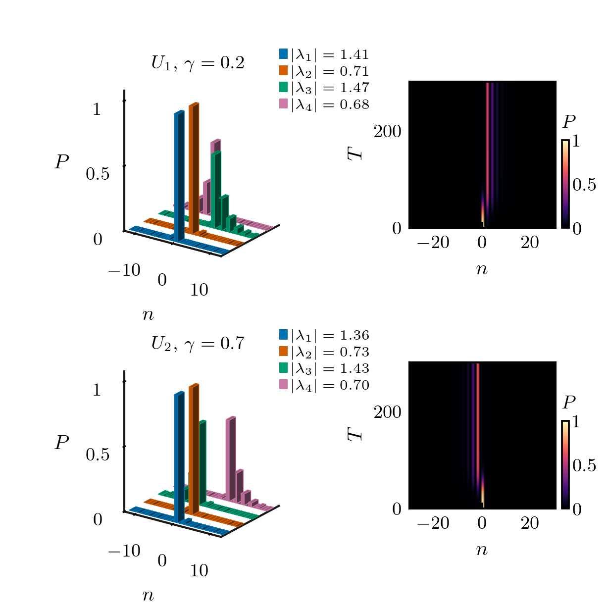

# Non-Hermitian quantum walks with a phase defect

Numerical study of defect-localized states and their time evolution in two
non-Hermitian discrete-time quantum walks. The calculations follow
R. Zhang, Y. Liu and T. Chen, *Physical Review A* **102**, 022218 (2020).



## Model and conventions

The two step operators are

$$
U_1=S_1G_1^{-1}R_1(\theta_2)S_1G_1R_1(\theta_1),
$$

$$
U_2=R_2(\theta_1/2)S_2R_2(\theta_2/2)G_2
R_2(\theta_2/2)S_2R_2(\theta_1/2).
$$

Here $R_1(\theta)=\exp(i\theta\sigma_x)$,
$R_2(\theta)=\exp(-i\theta\sigma_y)$,
$G_1=\mathrm{diag}(e^{-\gamma},e^\gamma)$, and
$G_2=\gamma|+\rangle\langle+|+\gamma^{-1}|-\rangle\langle-|$.
The unitary limits are $\gamma=0$ for $U_1$ and $\gamma=1$ for $U_2$.

The coin basis is $(\uparrow,\downarrow)$. Products act from right to left.
$S_1$ shifts the two components right and left, respectively; $S_2$ reverses
these directions. Each shift multiplies the amplitude at the departure site
$n=0$ by $e^{i\varphi}$ before translation. There are two shifts per full step.

The initial state is
$|0\rangle\otimes(|\uparrow\rangle+i|\downarrow\rangle)/\sqrt{2}$.
Time-evolution probabilities are normalized after every full step. Eigenvalues
and right eigenvectors are calculated from the linear, unnormalized step
operator. The plotted eigenstate profiles use the ordinary norm,
$P_n=|\psi_{n,\uparrow}|^2+|\psi_{n,\downarrow}|^2$.

## Installation and examples

Run from the repository root with Python 3.11 and the dependencies listed in
`requirements.txt` (including Matplotlib 3.10 or later):

```sh
python -m pip install -r requirements.txt
python -m examples.paper_cases
```

The example calculates localized modes and evolution through $T=300$. It
writes figures and six numerical archives to `examples/output/`. The archives
contain site coordinates, probabilities, eigenvalue moduli and eigenstate
profiles. To redraw them after the first calculation:

```sh
python -m examples.paper_cases --reuse-data
```

Figure export requires LaTeX with `latex`, `dvipng`, `type1cm`, `type1ec`,
`amsmath` and `textcomp`. On Ubuntu:

```sh
sudo apt-get install texlive-latex-extra cm-super dvipng ghostscript
```

## Parameter sets and figures

The main examples use $\theta_1=-4\pi/9$,
$\theta_2=5\pi/9+0.1113$, and defect phase $\varphi=\pi$.
The regime labels describe the defect-free bulk spectrum.

| Bulk regime | $\gamma$ in $U_1$ | $\gamma$ in $U_2$ | Figure |
| --- | ---: | ---: | --- |
| Unbroken | 0.01 | 0.95 | [Localized modes and evolution](docs/localization_unbroken.png) |
| Partially broken | 0.20 | 0.70 | [Localized modes and evolution](docs/localization_partially_broken.png) |
| Completely broken | 0.30 | 0.10 | [Localized modes and evolution](docs/localization_completely_broken.png) |

The [overview](docs/localization.png) collects all six cases. Eigenstate
profiles use three-dimensional layered bars with a common orthographic view,
bar width and probability-axis range. Each layer is one eigenstate. The color
legend identifies $|\lambda_i|$ with $i=1,2,3,4$ from front to back and gives
the moduli; the categorical depth axis has no tick labels. Evolution maps
retain their probability normalization and their common color scale. PDFs, SVGs and
300 dpi PNGs are provided in `docs/`. The figures use the shared
[publication style](docs/figure_style.md).

## Numerical checks

```sh
python -m unittest discover -s tests -v
OPENBLAS_NUM_THREADS=1 OMP_NUM_THREADS=1 python -m validation.run
```

The validation compares the four localized-mode probability profiles in each
of Appendix D Tables I–VI, checks eigenvalue residuals and finite-size
convergence, and examines the evolution in Figs. 2–5 and Appendix C.
The comparison to the printed table entries uses an absolute tolerance of
$1.1\times10^{-6}$.

Eigenstates are compared on 161- and 241-site periodic rings. Evolution uses
1301- and 1601-site rings; the maximum displacement at $T=300$ is 600 sites,
so the propagated state does not reach the periodic boundary in these runs.
Bulk phase boundaries are obtained from the continuous-Brillouin-zone
half-trace criterion. See [the numerical report](validation/report.json) for
parameters and residuals, and [the model notes](docs/reconstruction.md) for
the operator conventions and the individual comparisons.

## Reference

Rui Zhang, Yifan Liu and Tian Chen, “Non-Hermiticity-induced quantum control
of localization in quantum walks,” *Phys. Rev. A* **102**, 022218 (2020).
[DOI:10.1103/PhysRevA.102.022218](https://doi.org/10.1103/PhysRevA.102.022218).
BibTeX and citation metadata are provided in `citation.bib` and `CITATION.cff`.
