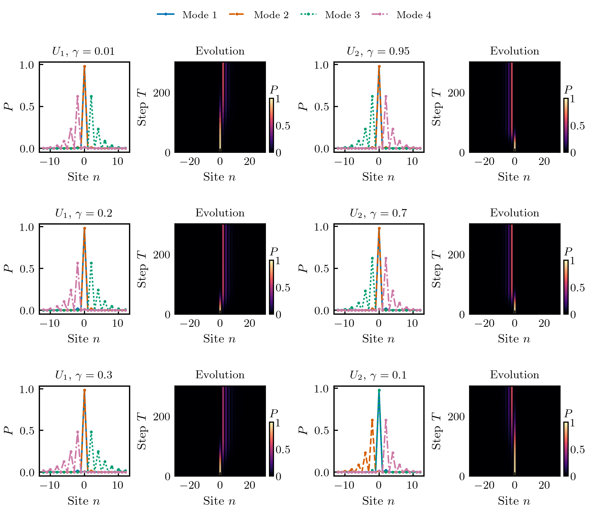

# Non-Hermitian quantum walks with a phase defect

Scientific code accompanying Rui Zhang, Yifan Liu and Tian Chen,
**Non-Hermiticity-induced quantum control of localization in quantum walks**,
Physical Review A **102**, 022218 (2020).
[Paper / DOI](https://doi.org/10.1103/PhysRevA.102.022218).

**This is a new implementation reconstructed from the paper in October 2026.
It is not the original 2020 source code.** It implements the two particular
non-Hermitian walks in Eqs. (1)-(2), including the defect convention, rather
than a generic quantum-walk demonstration. Selected published numerical
results are checked below; the repository does not claim a complete
reproduction of every figure or of the analytic Appendix B solution.

## Run

Python 3.11 was used for validation. From the repository root:

```sh
python -m pip install -r requirements.txt
OPENBLAS_NUM_THREADS=1 OMP_NUM_THREADS=1 python -m unittest discover -s tests -v
OPENBLAS_NUM_THREADS=1 OMP_NUM_THREADS=1 python -m validation.run
OPENBLAS_NUM_THREADS=1 OMP_NUM_THREADS=1 python -m examples.paper_cases
```

The example saves `examples/output/localization.png` and six NPZ files with
site coordinates, time probabilities, and localized right-eigenstate profiles.
The JSON validation report is versioned in `validation/report.json` and can be
regenerated. NumPy, SciPy and Matplotlib are the only external dependencies.
No original research files are needed; figure export requires LaTeX.

## Operator conventions

Amplitudes have shape `(2*N+1, 2)`, ordered by physical site `n=-N,...,N`
and coin `(up,down)`. Products act on column vectors from right to left.

* `U1 = S1 G1^-1 R1(theta2) S1 G1 R1(theta1)`, with
  `R1(theta)=exp(i theta sigma_x)` and `G1=diag(exp(-gamma),exp(gamma))`.
  Each `S1` shifts up right and down left.
* `U2 = R2(theta1/2) S2 R2(theta2/2) G2 R2(theta2/2) S2 R2(theta1/2)`,
  with `R2(theta)=exp(-i theta sigma_y)` and
  `G2=gamma |+><+| + gamma^-1 |-><-|`.
  Each `S2` shifts up left and down right. **Gamma uses a different
  parametrization from U1:** U1 is unitary at gamma=0; U2 at gamma=1.
* Every shift is `S_free D`: multiply `exp(i phase)` at the **departure**
  site n=0, then move. Apply the defect twice per full time step, at the two
  distinct shift operations. The paper's explicit G2 definition is used;
  its gain/loss prose has the opposite assignment to the +/- labels.
* Boundaries are periodic, exactly as in the mod formulas in the paper.
  The linear `step` and `matrix` functions never normalize. `evolve`
  normalizes after every full step, with the paper's initial state
  `(up+i down)/sqrt(2)` at n=0. Nonlinear normalized evolution must not be
  used to construct an eigensystem.

## What is validated

The main angles are `theta1=-4*pi/9`, `theta2=5*pi/9+0.1113`, phase `pi`.

| Paper anchor | Model | Gamma | Bulk regime | T=300 peak |
|---|---|---:|---|---:|
| Fig. 2(a,b), Appendix D Table I | U1 | .01 | unbroken | +2 |
| Fig. 2(c,d), Table II | U2 | .95 | unbroken | -2 |
| Fig. 3(a,b), Table III | U1 | .2 | partially broken | +2 |
| Fig. 3(c,d), Table IV | U2 | .7 | partially broken | -2 |
| Fig. 4(a,b), Table V | U1 | .3 | completely broken | +2 |
| Fig. 4(c,d), Table VI | U2 | .1 | completely broken | -2 |

`validation/paper_anchors.py` transcribes all four **numerical** eigenstate
columns at n=-4,-2,0,2,4 in each table (120 values). The 144 odd-site entries
at n=-5,-3,-1,1,3,5 are checked as zero within numerical precision, rather
than compared to their printed roundoff. Profiles are matched one-to-one
because eigensolvers need not preserve the paper's ordering. A tolerance of
1.1e-6 reflects the six-decimal printed probabilities; no machine-precision
agreement with rounded values is asserted. The paper's analytic and numeric
columns differ in some small entries, particularly in Table I. The analytic
columns are not silently substituted or fitted.

* Eigenproblems are solved on 161- and 241-site rings. Candidate localization
  requires >95% mass within |n|<=20, and >99.99% on even sites for the sector
  reached from n=0. Right eigenvectors have ordinary norm one. Residuals,
  boundary mass, eigenvalue and profile convergence are saved explicitly.
  Odd-sector defect modes are outside the comparison to Appendix D.
* Evolution uses 1301- and 1601-site rings (N=650 and 800), through T=300.
  Two shifts per step give a maximum displacement of 600, so these runs
  cannot reach a boundary. On an odd ring, parity is only an effective
  invariant before wrapping; do not assume it for arbitrarily long runs.
* Appendix A's half-traces determine the defect-free **bulk** regime using
  extrema over the continuous Brillouin zone. A separate `critical` label
  handles touching |d0|=1. Defect eigenvalues need not lie on the unit circle
  in a bulk-unbroken regime. Independent plane-wave and matrix-product
  checks verify the formulas and operator convention.
* Appendix C's six angle/gamma cases are checked for the qualitative peak
  displacement. Four Fig. 5 cases are checked for loss of probability from
  n=-2,0,+2 at T=300. This is qualitative agreement with the stated effect,
  not a pixel-level reproduction or recovery of original plot data.

## Scope and provenance

The full 13-page paper, its explicit operators, figures, Appendix A and
Appendix D were used to reconstruct and check this implementation.
[Reconstruction notes](docs/reconstruction.md) distinguish implemented
formulas, numerical reproduction, and qualitative checks. No publisher PDF,
original figure images, experimental data, or recovered 2020 code is bundled.

Use `CITATION.cff` or `citation.bib` to cite the associated paper.

## Generated example



## Figure exports

Figures follow [publication style v1](docs/figure_style.md): real LaTeX text
and mathematics, Computer Modern fonts, 10/9 pt typography, and compact figures
with approximately 2.5 cm square data frames, reference-matched typography,
and independent short, bottom-aligned colorbars labeled above. PDF, 300 dpi PNG,
SVG and typography records accompany every figure. Plotting now requires
a LaTeX installation; model evaluation and optimization remain independent
of the plotting toolchain.

The quantum-walk legends use 8 pt text; detailed eigenvalue moduli are
shown to two decimal places in the space beside each profile frame.
Full-precision values remain available in the saved numerical arrays.
